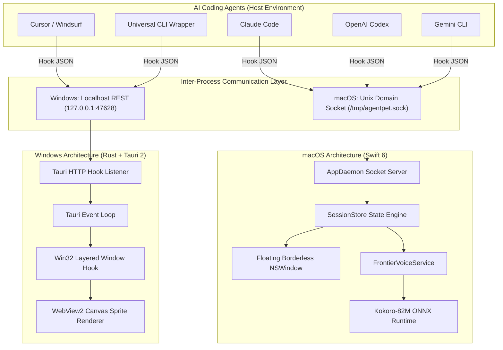

<div align="center">
  
  <p>
    
    
    
    
    
    
  </p>
  <p><b>An ambient, multi-agent desktop companion that reacts while your AI coding agents work, speaks with local and frontier neural voices, and keeps you deeply focused.</b></p>
</div>

---

## Table of Contents
- [Overview](#overview)
- [Installation Guide](#installation-guide)
  - [Windows Installation](#-windows-installation)
  - [macOS Installation](#-macos-installation)
- [Key Features & What Was Added Over Original Fork](#key-features--what-was-added-over-original-fork)
- [Technical Architecture](#technical-architecture)
  - [macOS Engine (Swift 6 & SwiftUI)](#macos-engine-swift-6--swiftui)
  - [Windows Engine (Rust & Tauri 2)](#windows-engine-rust--tauri-2)
  - [Multi-Agent IPC Protocol](#multi-agent-ipc-protocol)
- [Voice System Configuration](#voice-system-configuration)
- [Hook Setup for AI Agents](#hook-setup-for-ai-agents)
- [Building from Source](#building-from-source)
- [Upstream Credits & Fork Enhancements](#upstream-credits--fork-enhancements)
- [License](#license)

---

## Overview

When orchestrating multiple autonomous or interactive AI coding agents (**Claude Code**, **OpenAI Codex**, **Google Gemini CLI**, **Cursor**, **Windsurf**, **opencode**, **Antigravity**), developers constantly lose context on which agent is **executing**, which has **completed**, and which is **blocked waiting for permission**.

**AgentPet** provides real-time, non-intrusive awareness:
1. **Desktop Companion**: A floating pixel pet that idles quietly, types vigorously during agent execution, and raises attention bubbles when input is required.
2. **Neural Voice Communicator**: Announces tool completions, agent handoffs, and milestones with high-fidelity speech (100% offline **Kokoro-82M INT8** or cloud **Google Gemini** / **OpenAI**).
3. **Focus & Notification Suite**: Compact stacked notifications featuring a synchronized Pomodoro timer, stopwatch, ambient focus soundscapes, and 24-hour circadian progress arcs.

---

## Installation Guide

Pre-compiled production binaries for macOS and Windows are published on the **[Releases Page](https://github.com/amansaxna/agentPet/releases/latest)**.

### 🪟 Windows Installation

**Prerequisites**: Windows 10 (Build 19041+) or Windows 11 (64-bit). WebView2 Runtime is pre-installed on modern Windows installations.

Select one of the three installation formats:

#### Method 1: Standard Setup Installer (`.exe`) — Recommended
1. Download **`AgentPet_1.18.1_x64-setup.exe`** from [Releases](https://github.com/amansaxna/agentPet/releases/latest).
2. Double-click the installer. It installs per-user into `%LOCALAPPDATA%\Programs\AgentPet` (requires **no administrator/UAC privileges**).
3. **Windows SmartScreen Prompt**:
   > Because open-source builds are not signed with a paid ($400/yr) corporate EV certificate, Windows Defender SmartScreen may display *"Windows protected your PC"*.
   > 1. Click **More info**.
   > 2. Click **Run anyway**.
4. AgentPet will launch immediately, appearing in your system tray and as a transparent desktop overlay.

#### Method 2: Enterprise / Managed MSI Package (`.msi`)
1. Download **`AgentPet_1.18.1_x64_en-US.msi`**.
2. Run the Windows Installer wizard, or deploy silently via PowerShell / Command Prompt:
   ```powershell
   msiexec.exe /i AgentPet_1.18.1_x64_en-US.msi /qn
   ```

#### Method 3: Portable Zero-Install ZIP (`.zip`)
1. Download **`AgentPet-portable-x64.zip`**.
2. Extract the archive to any folder (e.g. `C:\Tools\AgentPet` or USB drive).
3. Run `agentpet.exe` directly. Leaves zero system or registry footprint.

---

### 🍎 macOS Installation

**Prerequisites**: macOS 13.0 (Ventura) or newer (Apple Silicon M1/M2/M3/M4 or Intel).

1. Download **`AgentPet-1.18.1.dmg`** from [Releases](https://github.com/amansaxna/agentPet/releases/latest).
2. Open the `.dmg` and drag **AgentPet.app** into `/Applications`.
3. Launch AgentPet from Launchpad, Spotlight, or Applications.
4. The companion will appear on your desktop and in your menu bar.

---

## Key Features & What Was Added Over Original Fork

This project is an advanced fork of `ntd4996/agentpet`. The table below outlines the major technical and functional additions introduced in this repository:

| Feature Dimension | Original Fork (`ntd4996/agentpet`) | This Fork (`amansaxna/agentPet`) |
| :--- | :--- | :--- |
| **Speech & Audio** | Text-only floating speech bubbles and basic macOS system chime. | **Multi-Engine Neural Voice Communicator**: 100% offline Kokoro-82M INT8 neural TTS, Google Gemini 2.5 Flash, OpenAI ChatGPT, and ElevenLabs. |
| **Voice Auditioning** | None. | **Interactive Inline Audio Preview**: Dedicated `▶ Test` button on every voice row to audition voices instantly before selecting. |
| **Audio Coexistence** | Overlapping sound effects. | **Smart Audio Precedence**: Focus background audio (Lofi, Rain, White noise) ducks/pauses cleanly during voice alerts without collision. |
| **Notification Pill** | Single static activity indicator; separate duplicate pills for focus music. | **Unified Dynamic Notification**: Stacked interactive widget with live Pomodoro countdown timer, stopwatch, and non-distracting desaturated controls. |
| **Mascot Rendering** | Fixed bounding box (tall non-square sprites suffered vertical aspect clipping). | **Aspect-Ratio Preserved Canvas**: Full-height sprite rendering + dismissable speech bubbles with a native `[X]` close button. |
| **Productivity Suite** | Token counter and basic level meter. | **24-Hour Day Arc & Target Countdown**: Circadian day/night cycle, bedtime chime reminders, milestone countdowns (e.g. exams, launches), and philosophical quote rotation. |
| **Auto-Updates** | Hardcoded to original author's feed (`ntd4996.github.io`). | **Decoupled Update Pipeline**: Direct Sparkle 2 RSS appcast and Tauri updater pointing to `amansaxna/agentPet` with custom Ed25519 signing. |
| **Sandboxing & Security** | Loose path assumptions causing macOS permission alerts on Documents. | **Zero-Permission Sandboxing**: All neural models and assets resolve strictly within `Bundle.main` and `Application Support`. |
| **CI/CD Pipeline** | Separate manual workflows for Mac and Windows. | **Unified Multi-Platform Pipeline**: Single parallel matrix workflow on GitHub Actions compiling macOS DMG + Windows NSIS/MSI/Portable in parallel. |

---

## Technical Architecture

AgentPet is designed for minimal CPU/memory overhead, operating as an ambient background process that stays under 1% CPU utilization during idle animation.



### macOS Engine (Swift 6 & SwiftUI)
* **Window Management**: Uses custom borderless `NSPanel` / `NSWindow` with `.floating` window level, `.canJoinAllSpaces`, and transparent backing store. Empty margin hits are ignored (`.ignoresMouseEvents`) allowing transparent click-through to underlying IDE windows.
* **Sprite Animation**: Sprites are rendered via Core Graphics / SwiftUI canvas slicing an 8×9 matrix (idle, walk, typing, alert, sleeping states) running on a 60 FPS display link timer.
* **On-Device Neural Voice**: Evaluates the quantized Kokoro-82M model (~88 MB) through an embedded inference runner with zero network traffic, synthesizing raw PCM audio into 24kHz waveforms via `AVAudioPlayer`.

### Windows Engine (Rust & Tauri 2)
* **Native Win32 Subsystem**: Written in Rust using `windows-sys` and Tauri v2. Utilizes `SetWindowLongPtrW` with `WS_EX_LAYERED` and `WS_EX_TRANSPARENT` for hardware-accelerated per-pixel alpha transparency.
* **Click-Through Transparency**: Mouse events within transparent regions pass directly through to underlying applications; only pixels belonging to the pet sprite or active bubble capture cursor interactions.
* **IPC Server**: Lightweight embedded HTTP daemon on port `47628` listening for stdin JSON events dispatched by agent hooks.

### Multi-Agent IPC Protocol
Any agent or external script communicates with AgentPet by dispatching a JSON payload over the socket/HTTP interface:

```json
{
  "agent": "claude",
  "state": "working",
  "session_id": "sess-4819",
  "task": "Refactoring authentication handler",
  "tool": "edit_file",
  "tokens": 4250
}
```

**State Transitions**:
* `working` &rarr; Pet transitions to rapid typing animation; status pill illuminates.
* `waiting` &rarr; Pet perks up; speech bubble raises with notification requesting human feedback.
* `done` &rarr; Companion celebrates; tokens are digested into XP points; completion chime or neural voice announcement plays.

---

## Voice System Configuration

AgentPet includes a built-in neural voice communicator accessible via **Settings &rarr; Voice**:

```
Settings → Voice
┌────────────────────────────────────────────────────────┐
│ [✔] Enable Verbal Communicator                          │
├────────────────────────────────────────────────────────┤
│ Provider: (●) Kokoro-82M (Offline)  ( ) Google Gemini  │
│           ( ) OpenAI ChatGPT        ( ) ElevenLabs     │
├────────────────────────────────────────────────────────┤
│ Voice Selection:                                       │
│   • Heart (Female - Balanced)             [▶ Test]     │
│   • Bella (Female - Expressive)           [▶ Test]     │
│   • Michael (Male - Formal)               [▶ Test]     │
│   • Adam (Male - Deep)                    [▶ Test]     │
├────────────────────────────────────────────────────────┤
│ Trigger Events:                                        │
│   [✔] Agent Task Completed                             │
│   [✔] Focus Timer Intervals                            │
│   [✔] Bedtime & Circadian Chimes                       │
└────────────────────────────────────────────────────────┘
```

1. **Kokoro-82M Local Neural (Default)**: Pre-bundled inside the application. Requires no API keys, accounts, or internet access.
2. **Google Gemini Neural**: Provides expressive conversational speech (`Aoede`, `Puck`, `Charon`) using Google's free-tier API (1,500 daily requests free at [Google AI Studio](https://aistudio.google.com/)).
3. **OpenAI ChatGPT**: Conversational voices (`Nova`, `Alloy`, `Echo`) using your OpenAI API key.

---

## Hook Setup for AI Agents

AgentPet can automatically configure hooks for your installed agents, or you can register them manually:

### Automatic Registration
* **macOS**: Click **Settings &rarr; Agents** and click **Install Hook** next to your agent.
* **Windows**: Open PowerShell in the AgentPet directory:
  ```powershell
  .\agentpet.exe hook --agent claude
  .\agentpet.exe hook --agent codex
  .\agentpet.exe hook --agent gemini
  ```

### Manual Configuration
* **Claude Code**: Add to `%USERPROFILE%\.claude\settings.json` (Windows) or `~/.claude/settings.json` (macOS):
  ```json
  {
    "hooks": {
      "postToolExecution": "agentpet hook --agent claude",
      "notification": "agentpet hook --agent claude"
    }
  }
  ```
* **Universal CLI Execution**: Run any command or tool under AgentPet's watch:
  ```bash
  agentpet run -- npm test
  agentpet run -- cargo build --release
  ```

---

## Building from Source

### Building macOS App

```bash
# Clone repository
git clone https://github.com/amansaxna/agentPet.git
cd agentPet

# Build release bundle
./scripts/build-app.sh release

# Launch
open build/AgentPet.app
```

### Building Windows App

```bash
cd windows

# Install frontend dependencies
npm install

# Run in development mode
npm run dev

# Compile production NSIS and MSI installers
npm run build
npm run tauri build
```

---

## Upstream Credits & Fork Enhancements

AgentPet was originally created and open-sourced by **[Nguyễn Thành Đạt (@ntd4996)](https://github.com/ntd4996)** and contributors at **[ntd4996/agentpet](https://github.com/ntd4996/agentpet)**.

We extend our gratitude to the original project for developing the initial multi-agent detection concept and sprite format. This fork maintains full compatibility with upstream pet spritesheets while significantly expanding audio synthesis, UI ergonomics, focus tracking, and multi-platform cloud CI automation.

---

## License

This project is licensed under the **MIT License** — see the [LICENSE](LICENSE) file for complete details.  
Pet sprites and artwork belong to their respective creators under their respective licensing models.